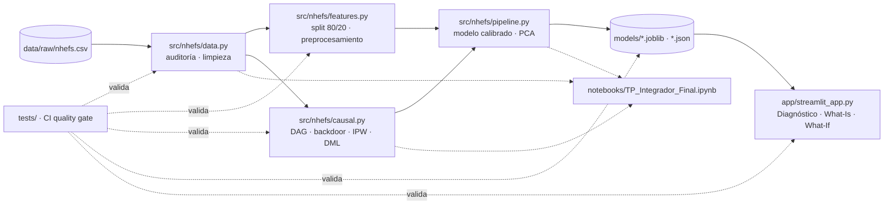

# NHEFS · Decision Intelligence Capstone


[](https://URL-DE-LA-APP.streamlit.app)

Trabajo Práctico Integrador de **Estadística Aplicada y Modelos de Regresión (EAyMR 2026)**, Licenciatura en Ciencia de Datos, UCA.
Autor: **Camilo Garcia Placeres**. Asume los cuatro roles Scrum.

> **App desplegada:** https://URL-DE-LA-APP.streamlit.app  ← *reemplazar después del deploy*

## 1 · Problema de negocio

Un programa de salud pública quiere promover que las personas dejen de fumar. Tiene dos preguntas:

1. **What-Is (predictiva):** ¿quiénes, dentro de una cohorte de fumadores, tienen mayor riesgo de morir en los próximos 10 años? La respuesta sirve para priorizar el seguimiento.
2. **What-If (causal):** si el programa logra que alguien deje de fumar, ¿cuánto peso gana *por haber dejado*? La respuesta sirve para dimensionar el apoyo nutricional que acompaña a la cesación.

**Datos:** NHANES I Epidemiologic Follow-up Study (NHEFS). Son 1.629 fumadores de 25 a 74 años entrevistados en 1971–75 y seguidos hasta 1982 (peso) y 1992 (mortalidad). Es la versión que usan Hernán y Robins en *Causal Inference: What If*.

## 2 · Resultados principales

| Pregunta | Resultado |
|---|---|
| Diferencia cruda de peso (dejó vs. siguió) | +2,54 kg [1,58; 3,50], Welch t = 5,21, p < 0,001, d = 0,33 |
| ATE backdoor (regresión, DoWhy) | **+3,35 kg** [2,48; 4,21] |
| ATE IPW / Double ML | +3,28 kg [2,37; 4,34] / +3,62 kg [2,67; 4,57] |
| Refutaciones (causa común aleatoria, placebo, subconjunto) | 🟢 🟢 🟢 |
| CATE | 3,21 + 0,044·cig/día − 0,011·edad; heterogeneidad no significativa |
| Mejor modelo predictivo de muerte | Logística regularizada y calibrada: AUC 0,847 · PR-AUC 0,547 · Brier 0,117 (línea base 0,158) |

El estimador ingenuo **subestima** el efecto. Quienes dejaron de fumar eran en promedio 3,4 años mayores, y la edad reduce el aumento de peso.

## 3 · Arquitectura



```
├── app/                 Web app Streamlit + requirements livianos para el deploy
├── data/raw/            NHEFS.csv y codebook (o scripts/download_data.py)
├── models/              Artefactos que consume la app
├── notebooks/           Notebook maestro (+ generador y textos)
├── scripts/             build_artifacts.py · download_data.py
├── src/nhefs/           Paquete: config, data, features, causal, pipeline
├── tests/               pytest: datos, fuga de datos, DAG, artefactos, app
├── slides/              Presentación ejecutiva (PDF)
├── BITACORA.md          Bitácora de investigación (5 entradas)
└── .github/             CI (ruff + pytest) y plantilla de PR con veredicto de QA
```

## 4 · Roles Scrum

| Rol | Responsabilidad en este repo |
|---|---|
| Project Lead | Encuadre de negocio, hipótesis, conclusiones (Fase 0, Entrada 1 de la bitácora) |
| Backend / ML-Causal | `data.py`, `features.py`, torneo de modelos, calibración, DAG, DoWhy, EconML (`pipeline.py`, `causal.py`) |
| Frontend | `app/streamlit_app.py`: los tres módulos de la web app y el despliegue |
| QA | `tests/`, CI, plantilla de PR con veredicto [APROBADO]/[BLOQUEADO] |

Los cuatro roles los asume el autor. La bitácora está firmada por rol.

## 5 · Cómo reproducir

```bash
git clone https://github.com/USUARIO/REPO.git && cd REPO
python -m venv .venv && source .venv/bin/activate      # Windows: .venv\Scripts\activate
pip install -r requirements.txt

python scripts/download_data.py        # opcional: los datos ya están en data/raw
python scripts/build_artifacts.py      # regenera /models (~3–5 min)
pytest                                 # 36 pruebas (pytest -m "not slow" para la versión rápida)
ruff check src app scripts tests
jupyter nbconvert --to notebook --execute --inplace notebooks/TP_Integrador_Final.ipynb
streamlit run app/streamlit_app.py
```

Semilla global: `SEED = 42` (`src/nhefs/config.py`). Probado con Python 3.13.

## 6 · Despliegue (Streamlit Community Cloud)

1. Subir este repositorio a GitHub, **incluida la carpeta `models/`**.
2. En share.streamlit.io: *New app* → repo → branch `main` → main file `app/streamlit_app.py`.
3. En *Advanced settings*, elegir Python 3.13. Streamlit usa `app/requirements.txt`, que está junto al archivo principal.
4. Copiar la URL en este README (badge y enlace de la sección 1).

## 7 · Uso de IA generativa

El código, los textos y la estructura del proyecto se desarrollaron con asistencia de **Claude (Anthropic)**. La trazabilidad completa está en la [Entrada 5 de la bitácora](BITACORA.md#entrada-5--trazabilidad-del-uso-de-ia): prompts, errores detectados y pruebas deterministas.

## 8 · Referencias

- Hernán, M. A. y Robins, J. M. (2020). *Causal Inference: What If*. Chapman & Hall/CRC.
- Pearl, J. (2009). *Causality* (2.ª ed.). Cambridge University Press.
- Sharma, A. y Kiciman, E. (2020). DoWhy: An end-to-end library for causal inference. arXiv:2011.04216.
- Chernozhukov, V. et al. (2018). Double/debiased machine learning. *The Econometrics Journal*, 21(1).
- Battocchi, K. et al. (2019). EconML. Microsoft Research.
- Breiman, L. (2001). Random Forests. *Machine Learning*, 45, 5–32.
- Niculescu-Mizil, A. y Caruana, R. (2005). Predicting good probabilities with supervised learning. *ICML*.
- Pedregosa, F. et al. (2011). Scikit-learn: Machine Learning in Python. *JMLR*, 12.
- Seabold, S. y Perktold, J. (2010). statsmodels. *Proc. 9th Python in Science Conf.*
